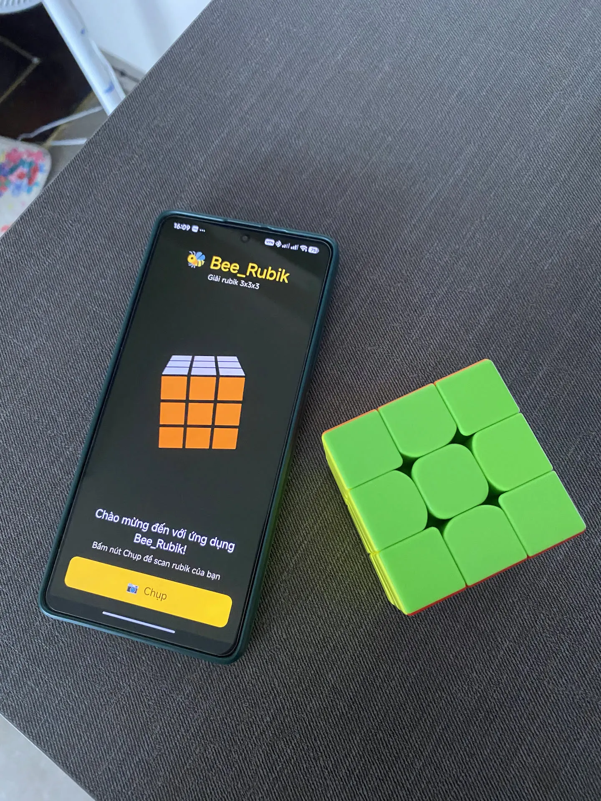
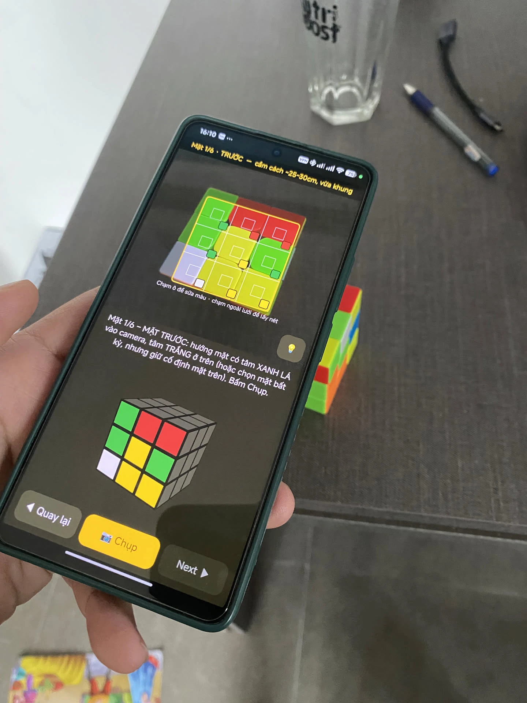
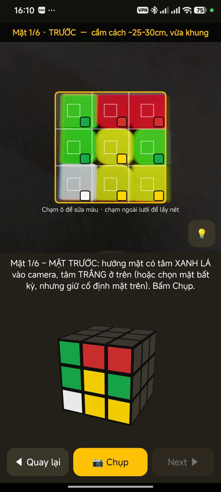
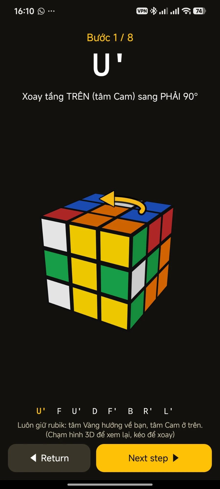

# 🐝 Bee_Rubik

Ứng dụng Android giải Rubik 3x3x3: quét 6 mặt bằng camera, hiển thị 3D, kiểm tra rubik bị sửa/lắp sai và hướng dẫn từng bước với lời giải ngắn (thuật toán hai pha Kociemba, trung bình ~19 bước).

## Tải APK
[`Bee_Rubik.apk`](Bee_Rubik.apk) — cho phép "cài ứng dụng không rõ nguồn gốc" rồi cài (Android 5.0+).

## Ảnh demo
<p>
  
  
</p>
<p>
  
  
</p>

## Tính năng
- Quét từng mặt với lưới 3×3, nhận diện màu trực tiếp, chạm ô để sửa màu.
- Hình 3D xoay + mũi tên chỉ cách lật rubik; tự chuyển mặt sau khi chụp.
- Phát hiện góc bị vặn, cạnh bị lật, ô đổi chỗ, màu không hợp lệ và hướng dẫn sửa.
- Màn hướng dẫn giải: số bước, Next step / Return, mũi tên 3D, góc nhìn tự do.

## Build từ mã nguồn
Cần JDK 17 và Android SDK (platform android-34, build-tools 34.0.0), không cần Gradle:

```bash
TOOLS=/duong/dan/android-build ./build.sh
```
`TOOLS` chứa thư mục `jdk-17*` và `sdk/`. Script tự tạo keystore mới (không đưa lên git); APK build ở máy khác sẽ có chữ ký khác bản đã phát hành nên cần gỡ bản cũ trước khi cài.

## Kiểm thử bộ giải (trên máy tính)
```bash
javac -d out src/com/bee/rubik/{CubeModel,CubeError,Cubie,Solver}.java test/SolverTest.java && java -cp out SolverTest
```
